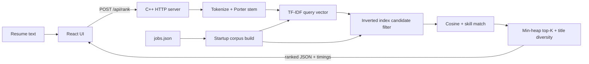

# Job Ranking Engine

> A transparent resume-to-job ranking system built to demonstrate classical
> information retrieval and algorithmic optimisation.

This **Analysis of Algorithms** mini project turns resume text into ranked job
matches using algorithms implemented from scratch in **C++17**. It deliberately
avoids IR/ML libraries so the indexing, scoring, and top-K trade-offs remain
visible and measurable.

## Why this project is interesting

- It combines tokenisation, Porter stemming, TF-IDF, an inverted index, cosine
  similarity, and min-heap top-K selection in one working pipeline.
- It reports stage timings with every ranking response instead of hiding the
  work behind a single score.
- It includes live and CLI benchmarks comparing naive and optimised strategies.
- It serves the React interface and REST API from one C++ process in production.

## Architecture



The production server also mounts `frontend/dist` when it exists, so the
compiled frontend and API share port `8080`.

## What's inside

| Layer     | Tech                            | Files |
|-----------|---------------------------------|-------|
| Algorithms| C++17, header-only modules      | `backend/algorithms/` |
| API       | cpp-httplib (vendored)          | `backend/main.cpp`, `backend/pipeline.h` |
| Benchmarks| median-of-100 harness (warm-up) | `backend/benchmark.h`, `experiments/run_benchmarks.cpp` |
| Frontend  | React 18 + Vite + Chart.js      | `frontend/` |
| Data      | 2,000 synthetic job postings    | `backend/data/jobs.json` |

### Algorithms (all with complexity doc-comments)

| Module | Purpose | Time |
|---|---|---|
| `tokenizer.h` | normalise, tokenise, stop-word removal (+ 2-letter tech-token whitelist: ai, ml, …) | O(L) |
| `stemmer.h` | full 5-step Porter Stemmer | O(W) |
| `tfidf.h` | TF-IDF vectors + L2 norms | O(total tokens) |
| `inverted_index.h` | term → postings, rarest-term overlap query | O(Σ df(t)) |
| `cosine.h` | sparse cosine similarity | O(min(\|v₁\|,\|v₂\|)) |
| `heap_topk.h` | min-heap top-K selection | O(N log K) |

## Quick start

Prerequisites: **CMake ≥ 3.16**, a **C++17 compiler**, and **Node.js 18+**.
The commands below use Windows PowerShell, which is the project’s documented
development environment.

```powershell
# 1. backend
cmake -S backend -B backend/build -G Ninja -DCMAKE_BUILD_TYPE=Release
cmake --build backend/build

# 2. frontend
cd frontend
npm install
npm run build
cd ..

# 3. run everything (API + built frontend on one port)
.\backend\build\server.exe --port 8080
# open http://localhost:8080
```

Omit `-G Ninja` if Ninja is not installed and use the CMake generator
available on your machine.

Development mode (frontend hot-reload, proxy to :8080):

```powershell
# terminal 1
.\backend\build\server.exe --port 8080

# terminal 2
cd frontend
npm run dev                              # http://localhost:3000
```

Vite proxies `/api/*` to the C++ server on port `8080` during development.

Regenerate the dataset (seeded, reproducible):

```powershell
python tools/generate_jobs.py --count 2000
```

## API

| Method | Path | Purpose |
|---|---|---|
| POST | `/api/rank` | `{ "resume_text": "...", "top_k": 10 }` → ranked jobs + timings |
| GET  | `/api/jobs?page=1&per_page=20&search=devops` | paginated listing |
| GET  | `/api/benchmark?max_n=2000&iterations=30` | runs both experiments |
| GET  | `/api/health` | status, jobs loaded, uptime |

## Benchmarks (FR-20/21, NFR-02/03)

```powershell
.\backend\build\run_benchmarks.exe --max-n 2000 --iterations 100 --output results\benchmarks.csv
```

Measured results (this machine, Release -O2, K=10, N=2000):

| Comparison | Baseline | Optimised | Speedup | Target |
|---|---|---|---|---|
| Brute force vs inverted index | 1.466 ms | 0.106 ms | **13.9×** | ≥ 3× (NFR-02) |
| Full sort vs min-heap top-K   | 0.022 ms | 0.003 ms | **8.9×**  | ≥ 1.5× (NFR-03) |

Both experiments are served live at **Benchmarks** tab in the UI (line/bar
charts, log scale, table view, CSV download).

## Project structure

```
backend/
  algorithms/   tokenizer, stemmer, tfidf, inverted_index, cosine, heap_topk
  pipeline.h    ranking pipeline orchestrator
  benchmark.h   timing harness + experiment definitions
  main.cpp      REST API server (4 endpoints) + static frontend hosting
  data/         jobs.json, stopwords.txt
  third_party/  httplib.h, nlohmann/json.hpp (vendored, header-only)
experiments/    run_benchmarks.cpp (CLI)
frontend/       React app: Rank tab + Benchmarks tab
tools/          generate_jobs.py (seeded dataset generator)
docs/           PRD.md, SPEC.md
results/        benchmarks.csv
```

Combined score (SPEC §3.10, FR-19): `0.7 × cosine + 0.3 × skill_match`, where
skill_match is the fraction of a job's structured skills found in the resume
(word-boundary-aware substring match — "java" never matches "javascript").

## V1 scope (deliberately cut)

PDF upload · BM25 · KMP phrase match · Levenshtein fuzzy match · unit test
suites · ground-truth quality evaluation — all marked *Should* in the PRD and
deferred to V2.

## License

No LICENSE file detected. Add a LICENSE to clarify project licensing.
